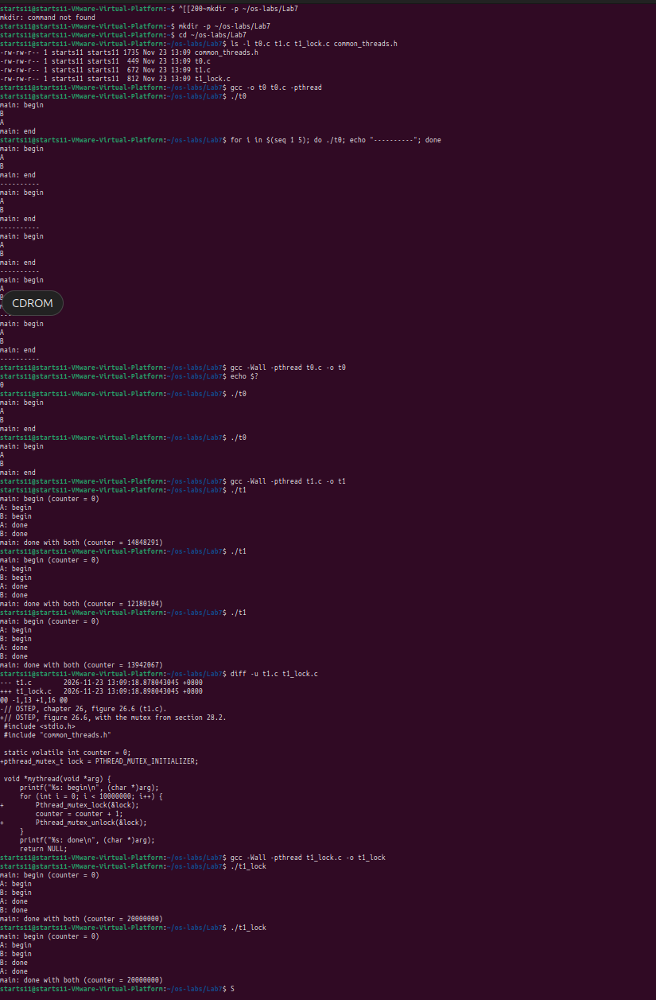
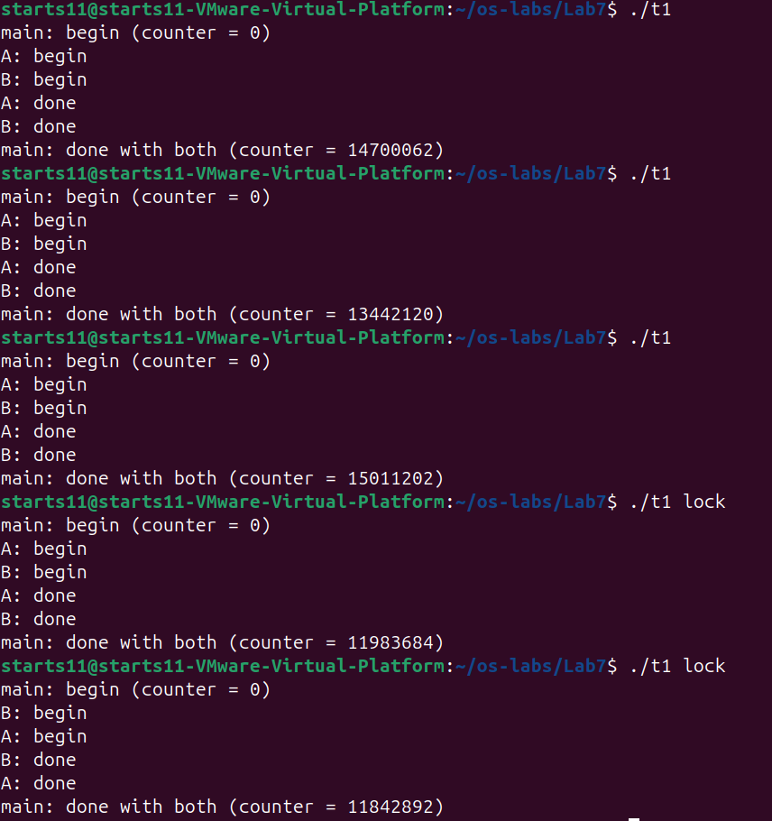

# Lab7：线程执行顺序、丢失更新与互斥锁

> **实验目标**：根据线程创建与等待操作判断输出顺序，推演共享计数器发生丢失更新的过程，并通过对照实验说明互斥锁的保护范围。
>
> **执行环境**：在前序实验使用的 Ubuntu 虚拟机中，通过 GCC 编译并运行仓库提供的 C 程序。
>
> **实验安排**：第 05 次课后 45 分钟用于环境准备和记录 A 至 D。结果分析、截图整理与报告提交可在课后完成。
>
> **提交材料**：实验报告 `Lab7.md` 及 `imgs` 目录下的两张运行截图。

## 一、实验文件

- `t0.c` 创建两个工作线程，用于观察主线程与工作线程的输出顺序。
- `t1.c` 使用两个线程更新同一个计数器，用于测量无锁更新的结果。
- `t1_lock.c` 在相同的计数操作前后加锁、解锁，用于与无锁程序对照。
- `common_threads.h` 提供创建线程、等待线程和操作互斥锁的宏。

### 阅读 C 程序的基本方法

在 Ubuntu 中，`.c` 文件保存程序的源代码，GCC 将源代码编译为可执行文件。例如，`./t0` 表示运行当前目录中名为 `t0` 的可执行文件。步骤 2、3、5 分别给出一个程序的完整代码。先通读代码，再结合下方引用的语句理解执行过程，完成预测后在 Ubuntu 终端编译运行。

- **函数与执行起点。** 函数是一段有名称的代码。`main` 是程序入口，程序启动时由主线程执行。`mythread` 是这里定义的另一个函数，创建工作线程时指定它为执行入口。函数在文件中的书写位置与实际执行顺序可以不同。
- **变量与地址。** 变量用于保存值，变量名用于访问这个值。例如，`p1` 保存线程标识，`&p1` 表示变量 `p1` 的内存地址。函数接收到这个地址后，可以将结果写入 `p1`。
- **语句与符号。** 函数名后的圆括号列出参数，多个参数用逗号分隔。花括号 `{` 和 `}` 标记一组语句的起止位置，分号 `;` 通常表示一条语句结束。双引号内的是文本，例如 `"A"`。`//` 至行末为注释，空行用于分隔代码。

## 二、实验步骤

### 步骤 1：准备本机报告和 Ubuntu 实验目录

**本机（Windows 或 macOS）**：在本人“10 位学号＋姓名”目录中建立 `Lab7/imgs`。将 `homework/Lab7/Lab7.md` 复制到本人目录下的 `Lab7` 文件夹，在副本中填写实验记录。

**Ubuntu 终端**：创建并进入实验目录。

```bash
mkdir -p ~/os-labs/Lab7
```

```bash
cd ~/os-labs/Lab7
```

**文件传输**。使用 scp 时，在本机仓库根目录执行以下命令，将占位的用户名和 IP 地址替换为虚拟机的实际值。使用 VS Code Remote-SSH 时，连接 Ubuntu 并将这四个文件上传至 `~/os-labs/Lab7/`。

```bash
scp homework/Lab7/t0.c homework/Lab7/t1.c homework/Lab7/t1_lock.c homework/Lab7/common_threads.h Ubuntu用户名@虚拟机IP:~/os-labs/Lab7/
```

在 **Ubuntu 终端**执行以下命令，确认四个文件均存在且大小大于 0。后续命令在该目录中逐条执行。

```bash
ls -l t0.c t1.c t1_lock.c common_threads.h
```

### 步骤 2：观察线程创建与等待对输出顺序的影响

**程序功能。** 主线程创建两个工作线程，分别传入字符串 A 和 B。两个工作线程各输出一行，主线程等待两者结束后输出结束标记。从主函数 `main` 开始阅读，再根据创建线程时传入的函数名找到工作线程的入口。

**`t0.c` 完整代码**

```c
// OSTEP, chapter 26, figure 26.2 (t0.c).
#include <stdio.h>
#include "common_threads.h"

void *mythread(void *arg) {
    printf("%s\n", (char *)arg);
    return NULL;
}

int main(void) {
    pthread_t p1, p2;
    printf("main: begin\n");
    Pthread_create(&p1, NULL, mythread, "A");
    Pthread_create(&p2, NULL, mythread, "B");
    Pthread_join(p1, NULL);
    Pthread_join(p2, NULL);
    printf("main: end\n");
    return 0;
}
```

**代码讲解**

> **引入函数声明**
>
> ```c
> #include <stdio.h>
> #include "common_threads.h"
> ```
>
> `#include <stdio.h>` 引入标准输入输出头文件，供后面的 `printf` 使用。`#include "common_threads.h"` 引入本实验使用的线程操作。

> **主线程开始执行**
>
> ```c
> int main(void) {
>     pthread_t p1, p2;
>     printf("main: begin\n");
> ```
>
> 程序从 `main` 开始执行。`int` 表示主函数返回整数状态码，括号内的 `void` 表示无参数。`pthread_t p1, p2;` 声明两个变量，用于保存稍后创建的线程标识。`printf` 输出开始标记，`\n` 表示换行。

> **创建两个工作线程**
>
> ```c
> Pthread_create(&p1, NULL, mythread, "A");
> Pthread_create(&p2, NULL, mythread, "B");
> ```
>
> 第一次调用将线程标识存入 `p1`（`&p1` 是它的地址），`NULL` 表示使用默认线程属性，`mythread` 指定新线程从哪个函数开始执行，`"A"` 是传给这个函数的字符串。第二次调用将标识存入 `p2`，传入的字符串为 `"B"`。两个线程创建后可以独立运行。

> **工作线程输出自己的标签**
>
> ```c
> void *mythread(void *arg) {
>     printf("%s\n", (char *)arg);
>     return NULL;
> }
> ```
>
> `void *arg` 接收创建线程时传入的地址。`(char *)arg` 将它作为字符地址使用，`%s` 输出对应的字符串，因此两个线程分别输出 A 或 B。函数名前的 `void *` 表示可以返回地址；执行 `return NULL;` 时，当前工作线程结束，返回空指针。

> **等待完成并结束程序**
>
> ```c
>     Pthread_join(p1, NULL);
>     Pthread_join(p2, NULL);
>     printf("main: end\n");
>     return 0;
> }
> ```
>
> 两个 `Pthread_join` 分别等待 `p1` 和 `p2` 对应的线程结束。若指定线程已结束，调用可以直接返回。这里的 `NULL` 表示忽略工作线程的返回值。两次等待都完成后，主线程输出结束标记，执行 `return 0;`，向操作系统返回正常结束状态。

**记录 A（输出顺序）**　运行前写出预计的首行和末行，并判断 A、B 两行的相对顺序是否固定。

| 预计首行 | 预计末行 | A、B 两行的先后是否固定 |
| :--- | :--- | :--- |
|  |  |  |

编译程序。命令中的 `gcc` 是编译器，`-Wall` 启用常用警告，`-pthread` 启用线程支持，`-o t0` 指定生成的可执行文件名为 `t0`。编译后立即执行 `echo $?`，检查编译命令的退出状态。

```bash
gcc -Wall -pthread t0.c -o t0
```

```bash
echo $?
```

退出状态为 0 后，将以下命令执行**两次**。按实际出现的顺序记录每次运行的四行输出。

```bash
./t0
```

| 运行次数 | 第一行 | 第二行 | 第三行 | 第四行 |
| :--- | :--- | :--- | :--- | :--- |
| 第一次 |main: begin  |A  | B | main: end |
| 第二次 |main: begin  |A  | B | main: end |

### 步骤 3：测量共享计数器的无锁更新结果

**程序功能。** 两个工作线程各执行一千万次加 1，并更新同一个整数。运行结果取自主线程最后一次输出。阅读时区分两个变量：`i` 记录当前线程完成了多少轮循环，`counter` 保存两个线程共同修改的计数值。

**`t1.c` 完整代码**

```c
// OSTEP, chapter 26, figure 26.6 (t1.c).
#include <stdio.h>
#include "common_threads.h"

static volatile int counter = 0;

void *mythread(void *arg) {
    printf("%s: begin\n", (char *)arg);
    for (int i = 0; i < 10000000; i++) {
        counter = counter + 1;
    }
    printf("%s: done\n", (char *)arg);
    return NULL;
}

int main(void) {
    pthread_t p1, p2;
    printf("main: begin (counter = %d)\n", counter);
    Pthread_create(&p1, NULL, mythread, "A");
    Pthread_create(&p2, NULL, mythread, "B");
    Pthread_join(p1, NULL);
    Pthread_join(p2, NULL);
    printf("main: done with both (counter = %d)\n", counter);
    return 0;
}
```

**代码讲解**

> **定义共享计数器**
>
> ```c
> static volatile int counter = 0;
> ```
>
> `int` 表示整数，`= 0` 指定初值。这个变量定义在函数外，两个线程共同访问它。`static` 将名称的可见范围限制在本源文件。`volatile` 要求按易变对象的规则访问该变量，但不保证两个线程的更新互斥。

> **输出初值并启动两个线程**
>
> ```c
> int main(void) {
>     pthread_t p1, p2;
>     printf("main: begin (counter = %d)\n", counter);
>     Pthread_create(&p1, NULL, mythread, "A");
>     Pthread_create(&p2, NULL, mythread, "B");
> ```
>
> 主函数声明线程标识 `p1` 和 `p2`。在 `printf` 中，`%d` 的位置显示逗号后 `counter` 的十进制整数值。此时工作线程尚未创建。随后两次 `Pthread_create` 分别将 A、B 传给同一个入口函数。

> **标记一次工作线程的执行**
>
> ```c
> void *mythread(void *arg) {
>     printf("%s: begin\n", (char *)arg);
> ```
>
> `arg` 保存标签的地址。`printf` 输出当前线程的标签和开始标记，例如 `A: begin`。

> **执行一千万次递增**
>
> ```c
> for (int i = 0; i < 10000000; i++) {
>     counter = counter + 1;
> }
> ```
>
> `int i = 0` 给当前线程的循环变量赋初值，只执行一次。每轮先检查 `i < 10000000`，成立时执行循环体，随后由 `i++` 将 i 加 1。两个线程各有自己的 i。循环中的 `counter = counter + 1;` 先读取共享值，计算加 1 的结果，再写回同一变量。例如，若读到 12，本次计算的写回值就是 13。

> **结束工作线程**
>
> ```c
>     printf("%s: done\n", (char *)arg);
>     return NULL;
> }
> ```
>
> 循环完成后，`printf` 输出对应线程的完成标记，`return NULL;` 结束本次工作线程的执行。

> **读取最终计数**
>
> ```c
>     Pthread_join(p1, NULL);
>     Pthread_join(p2, NULL);
>     printf("main: done with both (counter = %d)\n", counter);
>     return 0;
> }
> ```
>
> 主线程先后等待 A 和 B 结束，然后读取 `counter` 并输出。记录 B 的末行计数即来自这条 `printf` 语句。`return 0;` 表示程序正常结束。

**记录 B（无锁计数）**　运行前，根据初值 0、线程数及每个线程的循环次数，计算所有递增操作均生效时的预期值，写出算式。

| 计算式 | 预期最终计数 |
| :--- | :--- |
|  |  |

```bash
gcc -Wall -pthread t1.c -o t1
```

编译成功后，将以下命令执行**三次**。每次运行均创建新进程，计数器从 0 开始。记录首行的初值和末行 `main: done with both (counter = ...)` 中的最终值。差值等于预期值减去末行值。若多次结果相同，仍逐次记录。

```bash
./t1
```

| 运行次数 | 首行计数 | 末行计数 | 差值（预期值 − 末行计数） |
| :--- | :--- | :--- | :--- |
| 第一次 |0  |14848291  |14848291  |
| 第二次 |0  |12180104  |12180104  |
| 第三次 |0  |13942067  |13942067  |

### 步骤 4：推演线程交错执行时的丢失更新

本步采用简化的指令执行模型。设共享计数器初值为 **50**，线程 A、B 各执行一次递增。每次递增分三步完成：将计数值从内存读入寄存器，将寄存器中的值加 1，再将结果写回内存。线程切换时，系统保存和恢复相应的寄存器状态。

**记录 C（交错执行推演）**　按指定顺序填写每一步结束时两个线程各自的寄存器值及共享计数器值。线程尚未读取计数器时，在该线程的寄存器列填写“—”；数值保持不变时填写上一步的值。

| 步骤 | 线程操作 | A 的寄存器值 | B 的寄存器值 | 共享计数器值 |
| :--- | :--- | :--- | :--- | :--- |
| 初始 | 尚未读入 | — | — | 50 |
| 1 | A 从内存读入计数值 |50  |-  | 50 |
| 2 | A 在寄存器中加 1，随后切换到 B |51  |-  | 50 |
| 3 | B 从内存读入计数值 |51  |50  | 50 |
| 4 | B 在寄存器中加 1 |51  |51  |50  |
| 5 | B 写回内存，随后切换到 A |51  |51  |51  |
| 6 | A 写回内存 |51  |51  |51  |

对照条件为 A 完成全部三步后，B 再开始执行。计算此时 B 读入的计数值及两次递增完成后的最终值。

| B 读入的值 | 两次递增后的最终值 |
| :--- | :--- |
|50  |51  |

### 步骤 5：测量互斥锁保护下的计数结果

**程序功能。** 线程数、循环次数以及输出格式与无锁程序相同。每次更新计数器前，工作线程先获取互斥锁；写回后释放锁。观察两个线程使用的是哪一个锁对象，以及每次更新在何时获取和释放锁。

**`t1_lock.c` 完整代码**

```c
// OSTEP, figure 26.6, with the mutex from section 28.2.
#include <stdio.h>
#include "common_threads.h"

static volatile int counter = 0;
pthread_mutex_t lock = PTHREAD_MUTEX_INITIALIZER;

void *mythread(void *arg) {
    printf("%s: begin\n", (char *)arg);
    for (int i = 0; i < 10000000; i++) {
        Pthread_mutex_lock(&lock);
        counter = counter + 1;
        Pthread_mutex_unlock(&lock);
    }
    printf("%s: done\n", (char *)arg);
    return NULL;
}

int main(void) {
    pthread_t p1, p2;
    printf("main: begin (counter = %d)\n", counter);
    Pthread_create(&p1, NULL, mythread, "A");
    Pthread_create(&p2, NULL, mythread, "B");
    Pthread_join(p1, NULL);
    Pthread_join(p2, NULL);
    printf("main: done with both (counter = %d)\n", counter);
    return 0;
}
```

**代码讲解**

> **初始化计数器和锁**
>
> ```c
> static volatile int counter = 0;
> pthread_mutex_t lock = PTHREAD_MUTEX_INITIALIZER;
> ```
>
> `counter` 是初值为 0 的共享整数。`pthread_mutex_t` 是互斥锁类型，`PTHREAD_MUTEX_INITIALIZER` 将变量 `lock` 初始化为可获取状态。它定义在函数外，两个线程使用同一个锁对象。

> **启动加锁实验**
>
> ```c
> int main(void) {
>     pthread_t p1, p2;
>     printf("main: begin (counter = %d)\n", counter);
>     Pthread_create(&p1, NULL, mythread, "A");
>     Pthread_create(&p2, NULL, mythread, "B");
> ```
>
> 主函数声明两个线程标识并输出计数器初值。随后创建 A、B 两个工作线程，均从 `mythread` 入口开始执行。

> **标记工作线程开始**
>
> ```c
> void *mythread(void *arg) {
>     printf("%s: begin\n", (char *)arg);
> ```
>
> 入口函数通过 `arg` 接收标签字符串的地址。每个线程进入循环前各输出一次开始标记。

> **保护一次完整更新**
>
> ```c
> for (int i = 0; i < 10000000; i++) {
>     Pthread_mutex_lock(&lock);
>     counter = counter + 1;
>     Pthread_mutex_unlock(&lock);
> }
> ```
>
> 每个线程用自己的 i 控制循环次数。`Pthread_mutex_lock(&lock);` 获取共享锁；若另一线程持锁，当前线程在这个调用处等待。成功获取后才执行 `counter = counter + 1;`，读取旧值、加 1 并写回新值。`Pthread_mutex_unlock(&lock);` 随后释放锁。这两次锁操作之间的代码称为临界区。下一轮更新时需重新获取锁。

> **结束工作线程**
>
> ```c
>     printf("%s: done\n", (char *)arg);
>     return NULL;
> }
> ```
>
> 线程完成最后一次更新并释放锁后，输出自己的完成标记，随后返回空指针并结束。

> **输出对照结果**
>
> ```c
>     Pthread_join(p1, NULL);
>     Pthread_join(p2, NULL);
>     printf("main: done with both (counter = %d)\n", counter);
>     return 0;
> }
> ```
>
> 主线程等待两个工作线程结束后输出最终计数，用于填写记录 D。`return 0;` 返回正常结束状态。

逐行阅读后，用以下命令比较两个版本。差异正文中以 `+` 开头的代码行为加锁程序新增的内容。对照两处加锁、解锁调用在循环中的位置，再填写预测。

```bash
diff -u t1.c t1_lock.c
```

**记录 D（加锁计数）**　先写出加锁程序最终计数的预测值。编译成功后运行两次，逐次记录末行计数，并采用记录 B 的预期值计算差值。

| 程序 | 预计最终计数 |
| :--- | :--- |
| 加锁程序 |20000000  |

```bash
gcc -Wall -pthread t1_lock.c -o t1_lock
```

```bash
./t1_lock
```

| 运行次数 | 末行计数 | 差值（预期值 − 末行计数） |
| :--- | :--- | :--- |
| 第一次 |20000000  | 0 |
| 第二次 |20000000  |0  |

### 步骤 6：实验结果分析

1. 分别说明记录 A 中两次运行的 A、B 输出顺序。根据创建线程和两次 `Pthread_join` 调用的位置，指出程序保证的输出顺序，并说明依据。

2. 引用记录 B 中一次运行的最终值及差值。根据记录 C，指出覆盖更新所涉及的两次写回，并说明最后写回的线程、该线程读取旧值的步骤以及写回值。

3. 将记录 D 的一次结果与记录 B 的实测结果比较。假设记录 C 第 2 步结束时 A 仍持锁，此时切换至 B。指出 B 需要等待的函数调用，以及 A 写回并释放锁后 B 读取的变量及其值。据此说明临界区需要覆盖哪些操作。

| 题号 | 分析与依据 |
| :--- | :--- |
| 1　输出顺序 | 在记录 A（无锁程序）中，两次运行的输出顺序是不确定且可能交错的（例如：第一次可能是 A begin -> B begin -> A done -> B done，第二次可能是 B begin -> A begin -> B done -> A done）。
依据： 程序的执行顺序由操作系统的线程调度器决定。虽然主线程通过  pthread_create  依次创建了线程 A 和 B，并通过两次  pthread_join  等待它们结束，但这只保证了主线程会在两个子线程都结束后才继续执行，并不能保证线程 A 和 B 内部代码的执行先后顺序。它们并发运行，谁先获得 CPU 时间片就先输出，因此顺序是不确定的。 |
| 2　丢失更新 |记录 B（无锁程序）的最终值小于 20000000（例如 14848291），差值大于 0，说明发生了丢失更新。
依据：  counter = counter + 1  不是原子操作，分为“读取、加1、写回”三步。假设最终正确结果应为 20000000，而实际为 14848291，说明有 5151709 次更新丢失。
以一次具体的覆盖为例：假设当前内存中  counter  的值为  x 。

线程 A 读取旧值： A 读取  counter  的值为  x 。

线程切换： 此时发生线程切换，线程 B 获得 CPU。

线程 B 读取旧值： B 也读取  counter  的值，同样为  x 。

线程 B 计算并写回： B 计算  x + 1 ，并将结果  x + 1  写回内存。

线程 A 恢复并写回： A 恢复执行，它之前在寄存器中计算的结果也是  x + 1 ，A 将  x + 1  写回内存。
结论： 最后写回的线程（无论是 A 还是 B）覆盖了另一个线程的修改。这两个线程都读取了相同的旧值  x ，并都写回了  x + 1 ，导致本该增加 2 次的操作，最终只增加了 1 次，造成了更新丢失。  |
| 3　互斥保护 |记录 D（加锁程序）的最终值始终为 20000000，差值为 0，与记录 B 形成鲜明对比。
依据： 假设在记录 C 的第 2 步结束时（即线程 A 刚读取完旧值，尚未写回），线程 A 仍然持有锁，此时发生线程切换至 B。

B 需要等待： 线程 B 执行到  pthread_mutex_lock(&lock);  时，发现锁已被 A 占用，B 会被阻塞，必须等待 A 释放锁。

A 写回并释放锁： 线程 A 恢复执行，完成  counter = counter + 1  的计算，将新值写回内存，然后执行  pthread_mutex_unlock(&lock);  释放锁。

B 读取新值： 锁释放后，B 成功获取锁，进入临界区。此时 B 读取的  counter  变量已经是 A 更新后的新值（即  x + 1 ），而不是旧值  x 。B 基于新值进行加 1 并写回，结果为  x + 2 。
结论： 这说明临界区必须覆盖完整的“读取旧值 -> 计算新值 -> 写回内存”这三个步骤。只有将这三步作为一个不可分割的原子操作保护起来，才能防止其他线程在中间插入读取旧值，从而彻底避免丢失更新。  |

### 步骤 7：保存截图

- `imgs/lab7_threads.png`：保留两次 `./t0` 的命令与完整输出，分别对应记录 A 的两次运行。
- `imgs/lab7_counter.png`：保留三次 `./t1` 和两次 `./t1_lock` 的命令与完整输出，对应记录 B、D。输出超出一屏时，可分段截取并拼接，须保留各条命令及其对应输出。

将本人实验环境的终端截图保存为 PNG，置于报告同级的 `imgs` 目录，并在 Markdown 预览中检查图像是否完整、清晰。

![两个线程的输出顺序]

![共享计数器加锁前后的运行结果]

## 三、故障排查

- **GCC 提示找不到 `common_threads.h`。** 在 Ubuntu 执行步骤 1 的 `ls -l`，确认头文件与三个 C 文件位于同一目录。
- **终端提示找不到可执行文件。** 检查编译命令的退出状态和输出文件名，确认运行命令以 `./` 开头。
- **多次输出顺序相同，或无锁程序某次达到预期值。** 按实测结果填写。线程创建与等待的位置用于判断输出顺序，记录 C 用于分析可能发生的丢失更新。
- **加锁程序的最终值与预期值不符。** 核对预期值算式、编译状态和运行命令 `./t1_lock`。
- **`diff` 显示两份文件存在差异。** 在差异中定位共享锁的定义和循环内获取、释放锁的位置。

## 四、选读：互斥锁的保护范围

在记录 C 的条件下，假设两个线程均在锁外读取计数器并执行加法，仅在写回时获取同一把锁。可在两次写回前后分别标出获取锁和释放锁的位置，据此判断最终写回的值。本题供课堂讨论。

在 `t1.c` 中，`volatile` 不提供线程同步。两个线程无锁读写共享变量 `counter` 构成数据竞争，按 C 语言规则，程序行为未定义。记录 C 的手算展示了一种可能的指令交错。在 `t1_lock.c` 中，两个线程使用同一把互斥锁保护对计数器的更新。

## 五、提交要求

提交目录包含以下三个文件：

```text
学号姓名/
└── Lab7/
    ├── Lab7.md
    └── imgs/
        ├── lab7_threads.png
        └── lab7_counter.png
```

提交前核对：

- 记录 A 至 D 的预测、手算、实测与说明均已填写，三道分析题均已作答。
- 记录 A、B、D 的实测数据与本人运行截图一致；记录 C 按给定顺序手算。
- 图片在 Markdown 预览中显示正常。
- 报告保留模板正文、填写项与图片引用。
- 源码与可执行文件留在 Ubuntu 实验目录，不提交。

在本机仓库根目录检查工作区变更：

```bash
git status --short
```

按照仓库 README 暂存本人文件后，检查暂存范围：

```bash
git diff --cached --name-only
```

按照 README 同步上游后，检查本分支相对教师版本的改动：

```bash
git diff --name-status upstream/main
```

本次提交范围应限定为本人 Lab7 的上述三个文件。其他作业或越界修改按 README 处理，已经提交的历史作业应保留。PR 标题为：

```text
[学号姓名]Lab7作业提交
```

右方括号与 Lab7 之间不含空格，其余流程按仓库根目录 README 执行。

## 六、截止时间

**北京时间 2026 年 11 月 30 日 24:00（即 12 月 1 日 00:00）。**

提交时间以 GitHub 记录的最后一次向 PR 推送的时间为准。本次作业满分 10 分，迟交分档及 48 小时修正期的适用条件见仓库根目录 README 第 4 节。
