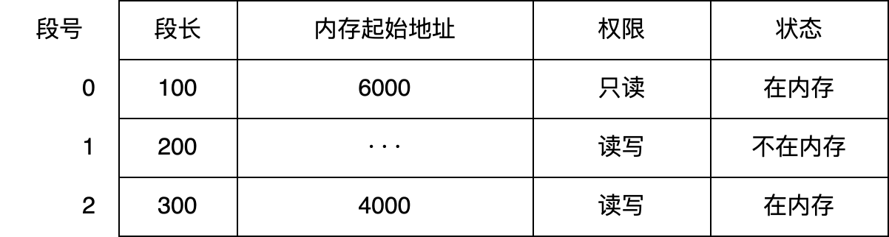

# Lab5：虚拟化——408 历年真题分类练习

> **作业目标**：通过 30 道 408 历年真题（2009–2026）选择题，按题型系统巩固「虚拟化」部分的核心内容：操作系统概述与系统调用、进程与状态转换、处理机调度、地址空间与分段、分页与地址转换。本卷题目均出自第 1～4 次课讲过、Lab1～Lab4 练过的知识点；中断与运行模式、线程与同步、虚拟内存与页面置换属于后续课程，不在本卷范围。
>
> 本次为纯书面作业，不要求编写程序、不要求截图。全卷按题型分组，不按年份排列，题号后的括号内仍标注真题年份，便于对照复习。
>
> **审核说明**：本次 PR 自动审核会检查 `Lab5.md` 与题图文件是否存在、题图是否被改动，以及每道选择题是否恰好勾选一个选项。自动审核不判断所选选项是否正确，内容正确性将在期末统一检测。空文件、未作答的模板或删改题目、选项的文件不能通过本次审核。

---

## 一、作答说明

1. 全卷共 30 道单项选择题，按题型分为五组，分组与题号如下：

   | 组别 | 题型 | 题号 | 题数 |
   | :--- | :--- | :--- | :---: |
   | 第一组 | 操作系统概述与系统调用 | 题 1～8 | 8 |
   | 第二组 | 进程、状态与上下文切换 | 题 9～14 | 6 |
   | 第三组 | 处理机调度 | 题 15～20 | 6 |
   | 第四组 | 地址空间与分段 | 题 21～24 | 4 |
   | 第五组 | 分页、页表与地址转换 | 题 25～30 | 6 |

2. 作答时将所选选项前的 `[ ]` 改为 `[x]`，每题只能勾选一项；不要删除其他选项，不要改动题面、选项顺序和题图。
3. 答案与解析不在本文件中，由课程统一发布；先独立完成，再核对订正。
4. 第四组的题 23 附有题图（段表），请对照图片作答，不要凭记忆判断段长与存取方式。
5. 第三组的周转时间、等待时间题，先在草稿纸上排出执行时间轴再代入公式；第五组的地址题，先按题面标注的位数切分地址，再查表。
6. 本次不涉及编程、不涉及截图，也不需要运行任何程序。

---

## 二、操作系统概述与系统调用（题 1～8）

### 题 1（2009 年）

单处理机系统中，可并行的是（D）。  
Ⅰ. 进程与进程 Ⅱ. 处理机与设备 Ⅲ. 处理机与通道 Ⅳ. 设备与设备

- [ ] A. Ⅰ、Ⅱ、Ⅲ
- [ ] B. Ⅰ、Ⅱ、Ⅳ
- [ ] C. Ⅰ、Ⅲ、Ⅳ
- [X] D. Ⅱ、Ⅲ、Ⅳ

### 题 2（2016 年）

下列关于批处理系统的叙述中，正确的是（A ）  
Ⅰ.批处理系统允许多个用户与计算机直接交互  
Ⅱ.批处理系统分为单道批处理系统和多道批处理系统  
Ⅲ.中断技术使得多道批处理系统的 I/O 设备可与 CPU 并行工作

- [X] A. 仅Ⅱ、Ⅲ
- [ ] B. 仅Ⅱ
- [ ] C. 仅Ⅰ、Ⅱ
- [ ] D. 仅Ⅰ、Ⅲ

### 题 3（2017 年）

与单道程序系统相比，多道程序系统的优点是（D ）  
Ⅰ.CPU 利用率高  
Ⅱ.系统开销小  
Ⅲ.系统吞吐量大  
Ⅳ.I/O 设备利用率高

- [ ] A. 仅Ⅰ、Ⅲ
- [ ] B. 仅Ⅰ、Ⅳ
- [ ] C. 仅Ⅱ 、Ⅲ
- [X] D. 仅Ⅰ、Ⅲ、Ⅳ

### 题 4（2018 年）

下列关于多任务操作系统的叙述中，正确的是（C ）。  
Ⅰ.具有并发和并行的特点  
Ⅱ.需要实现对共享资源的保护  
Ⅲ.需要运行在多 CPU 的硬件平台上

- [ ] A. 仅Ⅰ
- [ ] B. 仅Ⅱ
- [X] C. 仅Ⅰ、Ⅱ
- [ ] D. Ⅰ、Ⅱ、Ⅲ

### 题 5（2022 年）

下列关于多道程序系统的叙述中，不正确的是（D ）。

- [ ] A. 支持进程的并发执行
- [ ] B. 不必支持虚拟存储管理
- [ ] C. 需要实现对共享资源的管理
- [X] D. 进程数越多 CPU 利用率越高

### 题 6（2010 年）

下列选项中，操作系统提供给应用程序的接口是（A ）。

- [X] A. 系统调用
- [ ] B. 中断
- [ ] C. 库函数
- [ ] D. 原语

### 题 7（2012 年）

若一个用户进程通过 read 系统调用读取一个磁盘文件中的数据，则下列关于此过程的叙述中，正确的是（ A）。  
Ⅰ. 若该文件的数据不在内存中，则该进程进入睡眠等待状态  
Ⅱ. 请求 read 系统调用会导致 CPU 从用户态切换到核心态  
Ⅲ. read 系统调用的参数应包含文件的名称

- [X] A. 仅Ⅰ、Ⅱ
- [ ] B. 仅Ⅰ、Ⅲ
- [ ] C. 仅Ⅱ、Ⅲ
- [ ] D. Ⅰ、Ⅱ和Ⅲ

### 题 8（2021 年）

下列选项中，通过系统调用完成的操作是（C ）。

- [ ] A. 页置换
- [ ] B. 进程调度
- [X] C. 创建新进程
- [ ] D. 生成随机整数

---

## 三、进程、状态与上下文切换（题 9～14）

### 题 9（2014 年）

一个进程的读磁盘操作完成后，操作系统针对该进程必做的是（ A）。

- [X] A. 修改进程状态为就绪态
- [ ] B. 降低进程优先级
- [ ] C. 给进程分配用户内存空间
- [ ] D. 增加进程时间片大小

### 题 10（2015 年）

下列选项中，会导致进程从执行态变为就绪态的事件是（D ）。

- [ ] A. 执行 P(wait) 操作
- [ ] B. 申请内存失败
- [ ] C. 启动 I/O 设备
- [X] D. 被高优先级进程抢占

### 题 11（2020 年）

下列关于父进程与子进程的叙述中，错误的是（ B）。

- [ ] A. 父进程与子进程可以并发执行
- [X] B. 父进程与子进程共享虚拟地址空间
- [ ] C. 父进程与子进程有不同的进程控制块
- [ ] D. 父进程与子进程不能同时使用同一临界资源

### 题 12（2022 年）

下列事件或操作中，可能导致进程 P 由执行态变为阻塞态的是（D ）。  
Ⅰ. 进程 P 读文件  
Ⅱ. 进程 P 的时间片用完  
Ⅲ. 进程 P 申请外设  
Ⅳ. 进程 P 执行信号量的 wait() 操作

- [ ] A. 仅Ⅰ、Ⅳ
- [ ] B. 仅Ⅱ、Ⅲ
- [ ] C. 仅Ⅲ、Ⅳ
- [X] D. 仅Ⅰ、Ⅲ、Ⅳ

### 题 13（2024 年）

在支持页式存储管理的系统中，进程切换时 OS 要执行（D）。  
I. 更新 PC（程序计数器）值  
II. 更新栈基址寄存器值（ebp）  
III. 更新页表基址寄存器值

- [ ] A. 仅 III
- [ ] B. 仅 I、II
- [ ] C. 仅 I、III
- [X] D. I、II、III

### 题 14（2025 年）

在采用页式虚拟存储管理方式的系统中，当发生上下文切换时，下列寄存器中操作系统不需要更新的是（ D）。

- [ ] A. 通用寄存器
- [ ] B. 页表基址寄存器
- [ ] C. 程序计数器
- [X] D. 内核中断向量表基址寄存器

---

## 四、处理机调度（题 15～20）

### 题 15（2012 年）

一个多道批处理系统中仅有 P₁ 和 P₂ 两个作业， P₂ 比 P₁ 晚 5ms 到达，它们的计算和 I/O 操作顺序如下：  
P₁ ：计算 60ms，I/O 80ms，计算 20ms  
P₂ ：计算 120ms，I/O 40ms，计算 40ms  
若不考虑调度和切换时间，则完成两个作业需要的时间最少是（B）。

- [ ] A. 240ms
- [X] B. 260ms
- [ ] C. 340ms
- [ ] D. 360ms

### 题 16（2014 年）

下列调度算法中，不可能导致饥饿现象的是（A ）。

- [X] A. 时间片轮转
- [ ] B. 静态优先数调度
- [ ] C. 非抢占式短作业优先
- [ ] D. 抢占式短作业优先

### 题 17（2016 年）

某单 CPU 系统中有输入和输出设备各 1 台，现有 3 个并发执行的作业，每个作业的输入、计算和输出时间均分别为 2ms，3ms 和 4ms，且都按输入、计算和输出的顺序执行，则执行完 3 个作业需要的时间最少是（B）。

- [ ] A. 15ms
- [X] B. 17ms
- [ ] C. 22ms
- [ ] D. 27ms

### 题 18（2017 年）

假设 4 个作业到达系统的时刻和运行时间如下表所示。

| 作业 | 达到时刻 t | 运行时间 |
| --- | --- | --- |
| J₁ | 0 | 3 |
| J₂ | 1 | 3 |
| J₃ | 1 | 2 |
| J₄ | 3 | 1 |

系统在 t=2 时开始作业调度。若分别采用先来先服务和短作业优先调度算法，则选中的作业分别是（A ）。

- [A] A. J₂ 、 J₃
- [ ] B. J₁ 、 J₄
- [ ] C. J₂ 、 J₄
- [ ] D. J₁ 、 J₃

### 题 19（2017 年）

下列有关基于时间片的进程调度的叙述中，错误的是（B ）。

- [ ] A. 时间片越短，进程切换的次数越多，系统开销也越大
- [X] B. 当前进程的时间片用完后，该进程状态由执行态变为阻塞态
- [ ] C. 时钟中断发生后，系统会修改当前进程在时间片内的剩余时间
- [ ] D. 影响时间片大小的主要因素包括响应时间、系统开销和进程数量等

### 题 20（2024 年）

假设某系统使用时间片轮转调度算法进行 CPU 调度，时间片大小为 5 ms，系统共有 10 个进程，初始时均处于就绪队列，执行结束前仅处于执行态或就绪态。若队尾的进程 P 所需 CPU 时间最短，时间为 25 ms。在不考虑系统开销的情况下，则进程 P 的周转时间为（B ）。

- [ ] A. 200ms
- [X] B. 205ms
- [ ] C. 250ms
- [ ] D. 295ms

---

## 五、地址空间与分段（题 21～24）

### 题 21（2009 年）

一个分段存储管理系统中，地址长度为 32 位，其中段号占 8 位，则最大段长是（C）。

- [ ] A. 2⁸ 字节
- [ ] B. 2¹⁶ 字节
- [C] C. 2²⁴ 字节
- [ ] D. 2³² 字节

### 题 22（2011 年）

在虚拟内存管理中，地址变换机构将逻辑地址变换为物理地址，形成该逻辑地址的阶段是（B）。

- [ ] A. 编辑
- [B] B. 编译
- [ ] C. 链接
- [ ] D. 装载

### 题 23（2016 年）

某进程的段表内容如下所示。



当访问段号为 2、段内地址为 400 的逻辑地址时，进行地址转换的结果是（ D）。

- [ ] A. 段缺失异常
- [ ] B. 得到内存地址 4400
- [ ] C. 越权异常
- [X] D. 越界异常

### 题 24（2019 年）

在分段存储管理系统中，用共享段表描述所有共享的段。若进程 P1 和 P2 共享段 S，下列叙述中，错误的是（B ）。

- [ ] A. 在物理内存中仅保存一份段 S 的内容
- [B] B. 段 S 在 P1 和 P2 中应该具有相同的段号
- [ ] C. P1 和 P2 共享段 S 在共享段表中的段表项
- [ ] D. P1 和 P2 都不再使用段 S 时才回收段 S 所占的内存空间

---

## 六、分页、页表与地址转换（题 25～30）

### 题 25（2023 年）

进程 R 和 S 共享数据 data，若 data 在 R 和 S 中所在页的页号分别为 p1 和 p2，两个页所对应的页框号分别为 f1 和 f2，则下列叙述中，正确的是（C ）。

- [ ] A. p1 和 p2 一定相等，f1 和 f2 一定相等
- [ ] B. p1 和 p2 一定相等，f1 和 f2 不一定相等
- [C] C. p1 和 p2 不一定相等，f1 和 f2 一定相等
- [ ] D. p1 和 p2 不一定相等，f1 和 f2 不一定相等

### 题 26（2026 年）

进程 P1 和 P2 共享一个文件 R，该文件的页表项分别是 R1 和 R2，其在 2 个进程中的虚拟地址分别是 W1 和 W2，则下列说法中正确的是（ D）

- [ ] A. 页表项 R1 和 R2 的内容完全不同
- [ ] B. W1 和 W2 映射的物理地址相同
- [ ] C. 进程 P1 对 W1 的修改不会影响 P2 对 W2 的访问
- [X] D. W1 和 W2 虚拟地址相同

### 题 27（2011 年）

在缺页处理过程中，操作系统执行的操作可能是（B）。  
I、修改页表  
II、磁盘 I/O  
III、分配页框

- [ ] A. 仅 I、II
- [B] B. 仅 II
- [ ] C. 仅 III
- [ ] D. I、II 和 III

### 题 28（2014 年）

下列措施中，能加快虚实地址转换的是（C ）。  
I. 增大快表 (TLB) 容量  
II. 让页表常驻内存  
III. 增大交换区 (swap)

- [ ] A. 仅 I
- [ ] B. 仅 II
- [C] C. 仅 I、II
- [ ] D. 仅 II、III

### 题 29（2023 年）

对于采用虚拟内存管理方式的系统，下列关于进程虚拟地址空间的叙述中，错误的是（ D）。

- [ ] A. 每个进程都有自己独立的虚拟地址空间
- [ ] B. C 语言中 malloc() 函数返回的是虚拟地址
- [ ] C. 进程对数据段和代码段可以有不同的访问权限
- [D] D. 虚拟地址的大小由主存和硬盘的大小决定

### 题 30（2026 年）

在支持虚拟存储器系统下的指令执行过程中，正确的是（D）

- [ ] A. 地址转换由操作系统完成
- [ ] B. 页表项的内容由编译器确定
- [ ] C. 缺页中断由硬件直接处理
- [X] D. 异常由操作系统处理

---

## 七、提交要求

将本文件复制到自己的 `学号姓名/Lab5/Lab5.md`，完成全部选择题作答。最终只提交以下文件：

```text
学号姓名/
└── Lab5/
    ├── Lab5.md
    └── imgs/
        └── 2016_q28_stem1.png
```

- `imgs/` 中共有 1 张题图（供题 23 使用），须从 `homework/Lab5/imgs/` 原样复制，不得修改、重命名或替换；缺少该题图文件，或改动 `Lab5.md` 中的图片引用路径，均判为不完整。
- 每道单项选择题必须且只能将一个选项的 `[ ]` 改为 `[x]`，全卷恰好 30 处 `[x]`；不能全部不选，也不能同时选择多项。
- `Lab5.md` 必须保留全部 30 道题目与全部选项（共 120 个选项），不要改动题面、选项顺序和题图引用路径。
- 答案与解析由课程统一发布，提交的文件中不要自行添加答案、答案速查表或解析。
- 不需要提交程序、截图、可执行文件或其他编译产物。
- `Lab5`、`Lab5.md` 的大小写必须完全一致。
- PR 标题必须严格使用 `[学号姓名]Lab5作业提交`，右方括号后不能有空格。
- 一个 PR 只能包含本次 Lab5 的文件，不得修改其他同学、`homework/`、README 或仓库配置。

---

## 八、截止时间

**2026 年 11 月 9 日 24:00（即 2026 年 11 月 10 日 00:00，北京时间）**

以 GitHub 记录的最后一次向 PR 推送代码的时间为准。不晚于上述时刻创建 PR 并完成最后一次推送不算超时；超过该时刻新建 PR，或向已有 PR 推送任何修改，均算作超时。审核未通过的同学请在截止前完成修改。
