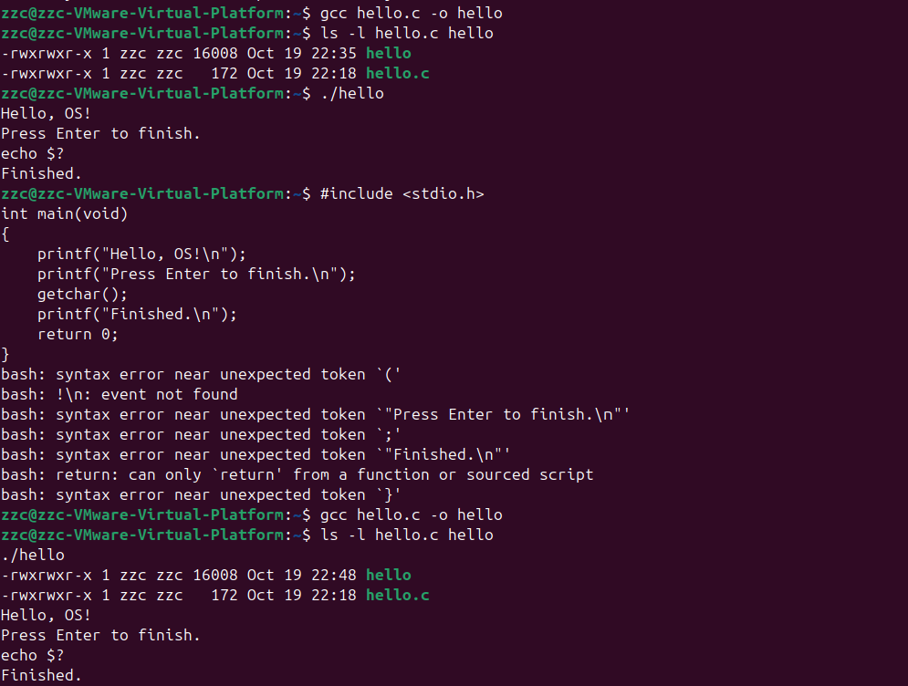
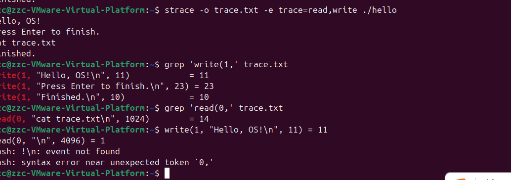

# Lab2：程序的编译、运行与系统调用观察

## 截图要求

| 截图说明 | 截图 |
| ---- | ---- |
| 身份标记、编译命令（无报错）、`./hello` 的完整输出 |  |
| strace 命令、本人程序输出、真实的 `write(1,...)` 与 `read(0,...)` |  |

---
## 提交要求
在自己的【学号姓名】文件夹下新建 `Lab2/`，提交填写完整的 `Lab2.md` 和全部 2 张截图：
```text
学号姓名/
└── Lab2/
    ├── Lab2.md
    └── imgs/
        ├── lab2_build_run.png
        └── lab2_syscalls.png
