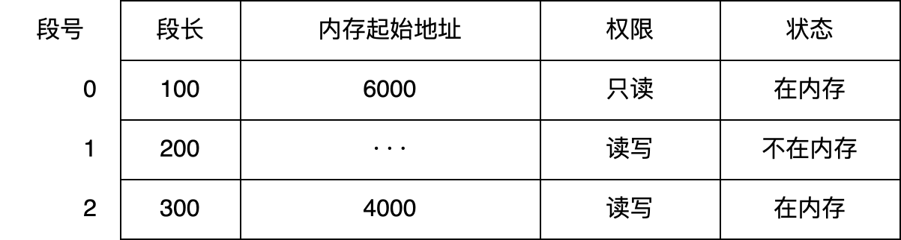
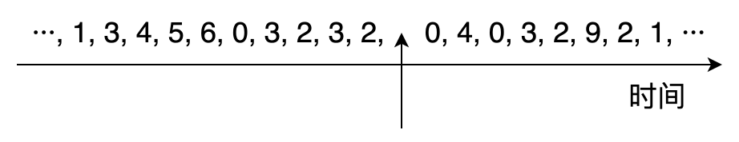
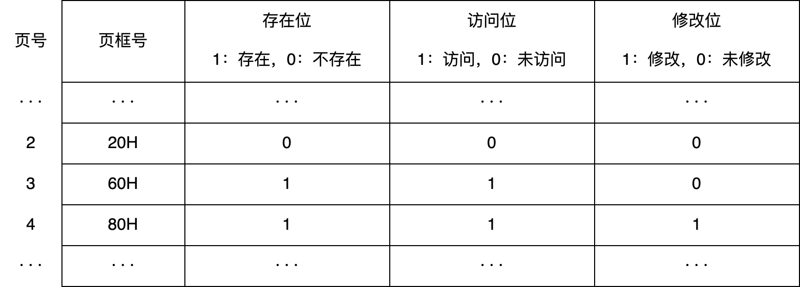

# Lab6：虚拟化——408 历年真题分类练习

> **作业目标**：通过 105 道 408 历年真题（2009–2026）选择题，按题型系统巩固「虚拟化」一章的核心内容：操作系统概述与内核结构、处理器运行模式与系统调用、进程与线程、处理机调度、连续分配与分页分段、虚拟内存与页面置换。请先独立作答，再对照课程统一发布的答案与解析核对订正；涉及时间轴与页框状态的题目，建议在草稿纸上逐步推演；涉及地址结构的题目，先按题图标注的位数切分地址，再逐级查表。
>
> 本次为纯书面作业，不要求编写程序、不要求截图。全卷按题型分组，不按年份排列，题号后的括号内仍标注真题年份，便于对照复习。
>
> **审核说明**：本次 PR 自动审核会检查 `Lab6.md` 与题图文件是否存在、题图是否被改动，以及每道选择题是否恰好勾选一个选项。自动审核不判断所选选项是否正确，内容正确性将在期末统一检测。空文件、未作答的模板或删改题目、选项的文件不能通过本次审核。

---

## 一、作答说明

1. 全卷共 105 道单项选择题，按题型分为六组，分组与题号如下：

   | 组别 | 题型 | 题号 | 题数 |
   | :--- | :--- | :--- | :---: |
   | 第一组 | 操作系统概述、内核结构与虚拟化 | 题 1～8 | 8 |
   | 第二组 | 处理器运行模式、中断异常与系统调用 | 题 9～29 | 21 |
   | 第三组 | 进程、线程与进程通信 | 题 30～47 | 18 |
   | 第四组 | 处理机调度 | 题 48～67 | 20 |
   | 第五组 | 内存管理基础：连续分配、分页与分段 | 题 68～84 | 17 |
   | 第六组 | 虚拟内存、地址转换与页面置换 | 题 85～105 | 21 |

2. 作答时将所选选项前的 `[ ]` 改为 `[x]`，每题只能勾选一项；不要删除其他选项，不要改动题面、选项顺序和题图。
3. 答案与解析不在本文件中，由课程统一发布；先独立完成，再核对订正。
4. 第五组、第六组的部分题目附有题图（段表、页表、地址位域结构），请对照图片作答，不要凭记忆判断位数。
5. 第四组的周转时间、等待时间题，先在草稿纸上排出执行时间轴再代入公式；第六组的置换题，按访问顺序逐次记录页框内容。
6. 本次不涉及编程、不涉及截图，也不需要运行任何程序。

---

## 二、操作系统概述、内核结构与虚拟化（题 1～8）

### 题 1（2009 年）

单处理机系统中，可并行的是（）。  
Ⅰ. 进程与进程 Ⅱ. 处理机与设备 Ⅲ. 处理机与通道 Ⅳ. 设备与设备

- [ ] A. Ⅰ、Ⅱ、Ⅲ
- [ ] B. Ⅰ、Ⅱ、Ⅳ
- [ ] C. Ⅰ、Ⅲ、Ⅳ
- [ ] D. Ⅱ、Ⅲ、Ⅳ

### 题 2（2013 年）

计算机开机后，操作系统最终被加载到（ ）。

- [ ] A. BIOS
- [ ] B. ROM
- [ ] C. EPROM
- [ ] D. RAM

### 题 3（2016 年）

下列关于批处理系统的叙述中，正确的是（ ）  
Ⅰ.批处理系统允许多个用户与计算机直接交互  
Ⅱ.批处理系统分为单道批处理系统和多道批处理系统  
Ⅲ.中断技术使得多道批处理系统的 I/O 设备可与 CPU 并行工作

- [ ] A. 仅Ⅱ、Ⅲ
- [ ] B. 仅Ⅱ
- [ ] C. 仅Ⅰ、Ⅱ
- [ ] D. 仅Ⅰ、Ⅲ

### 题 4（2017 年）

与单道程序系统相比，多道程序系统的优点是（ ）  
Ⅰ.CPU 利用率高  
Ⅱ.系统开销小  
Ⅲ.系统吞吐量大  
Ⅳ.I/O 设备利用率高

- [ ] A. 仅Ⅰ、Ⅲ
- [ ] B. 仅Ⅰ、Ⅳ
- [ ] C. 仅Ⅱ 、Ⅲ
- [ ] D. 仅Ⅰ、Ⅲ、Ⅳ

### 题 5（2018 年）

下列关于多任务操作系统的叙述中，正确的是（ ）。  
Ⅰ.具有并发和并行的特点  
Ⅱ.需要实现对共享资源的保护  
Ⅲ.需要运行在多 CPU 的硬件平台上

- [ ] A. 仅Ⅰ
- [ ] B. 仅Ⅱ
- [ ] C. 仅Ⅰ、Ⅱ
- [ ] D. Ⅰ、Ⅱ、Ⅲ

### 题 6（2022 年）

下列关于多道程序系统的叙述中，不正确的是（ ）。

- [ ] A. 支持进程的并发执行
- [ ] B. 不必支持虚拟存储管理
- [ ] C. 需要实现对共享资源的管理
- [ ] D. 进程数越多 CPU 利用率越高

### 题 7（2023 年）

与宏内核操作系统相比，下列特征中微内核操作系统具有的是（ ）。  
Ⅰ. 较好的性能  
Ⅱ. 较高的可靠性  
Ⅲ. 较高的安全性  
Ⅳ. 较强的可扩展性

- [ ] A. Ⅱ、Ⅳ
- [ ] B. Ⅰ、Ⅱ、Ⅲ
- [ ] C. Ⅰ、Ⅲ、Ⅳ
- [ ] D. Ⅱ、Ⅲ、Ⅳ

### 题 8（2025 年）

关于虚拟化技术，下列说法错误的是（ ）。

- [ ] A. 操作系统可以在虚拟机上运行
- [ ] B. 一台主机可以支持多个虚拟机
- [ ] C. VMM 与操作系统特权级相同
- [ ] D. 通过虚拟机技术，可以用一台主机上模拟多种 ISA

---

## 三、处理器运行模式、中断异常与系统调用（题 9～29）

### 题 9（2010 年）

下列选项中，操作系统提供给应用程序的接口是（ ）。

- [ ] A. 系统调用
- [ ] B. 中断
- [ ] C. 库函数
- [ ] D. 原语

### 题 10（2011 年）

下列选项中，在用户态执行的是（ ）。

- [ ] A. 命令解释程序
- [ ] B. 缺页处理程序
- [ ] C. 进程调度程序
- [ ] D. 时钟中断处理程序

### 题 11（2012 年）

下列选项中，不可能在用户态发生的事件是（ ）。

- [ ] A. 系统调用
- [ ] B. 外部中断
- [ ] C. 进程切换
- [ ] D. 缺页

### 题 12（2012 年）

中断处理和子程序调用都需要压栈以保护现场，中断处理一定会保存而子程序调用不需要保存其内容的是（ ）。

- [ ] A. 程序计数器
- [ ] B. 程序状态字寄存器
- [ ] C. 通用数据寄存器
- [ ] D. 通用地址寄存器

### 题 13（2012 年）

若一个用户进程通过 read 系统调用读取一个磁盘文件中的数据，则下列关于此过程的叙述中，正确的是（ ）。  
Ⅰ. 若该文件的数据不在内存中，则该进程进入睡眠等待状态  
Ⅱ. 请求 read 系统调用会导致 CPU 从用户态切换到核心态  
Ⅲ. read 系统调用的参数应包含文件的名称

- [ ] A. 仅Ⅰ、Ⅱ
- [ ] B. 仅Ⅰ、Ⅲ
- [ ] C. 仅Ⅱ、Ⅲ
- [ ] D. Ⅰ、Ⅱ和Ⅲ

### 题 14（2013 年）

下列选项中，会导致用户进程从用户态切换到内核态的操作是（ ）。  
I. 整数除以零  
II. sin() 函数调用  
III. read 系统调用

- [ ] A. 仅 I、II
- [ ] B. 仅 I、III
- [ ] C. 仅 II、III
- [ ] D. I、II 和 III

### 题 15（2014 年）

下列指令中，不能在用户态执行的是（ ）。

- [ ] A. trap 指令
- [ ] B. 跳转指令
- [ ] C. 压栈指令
- [ ] D. 关中断指令

### 题 16（2015 年）

处理外部中断时，应该由操作系统保存的是（ ）。

- [ ] A. 程序计数器（PC）的内容
- [ ] B. 通用寄存器的内容
- [ ] C. 块表（TLB）中的内容
- [ ] D. Cache 中的内容

### 题 17（2015 年）

假定下列指令已装入指令寄存器，则执行时不可能导致 CPU 从用户态变为内核态（系统态）的是（ ）。

- [ ] A. DIV R0, R1; (R0)/(R1)→R0
- [ ] B. INT n; 产生软中断
- [ ] C. NOT R0; 寄存器 R0 的内容取非
- [ ] D. MOV R0, addr; 把地址 addr 的内存数据放入寄存器 R0 中

### 题 18（2017 年）

执行系统调用的过程包括如下主要操作：  
①返回用户态 ②执行陷入（trap）指令  
③传递系统调用参数 ④执行相应的服务程序  
正确的执行顺序是（ ）。

- [ ] A. ②→③→①→④
- [ ] B. ②→④→③→①
- [ ] C. ③→②→④→①
- [ ] D. ③→④→②→①

### 题 19（2019 年）

下列关于系统调用的叙述中，正确的是（ ）。  
Ⅰ.在执行系统调用服务程序的过程中，CPU 处于内核态  
Ⅱ.操作系统通过提供系统调用避免用户程序直接访问外设  
Ⅲ.不同的操作系统为应用程序提供了统一的系统调用接口  
Ⅳ.系统调用是操作系统内核为应用程序提供服务的接口

- [ ] A. 仅Ⅰ、Ⅳ
- [ ] B. 仅Ⅱ、Ⅲ
- [ ] C. 仅Ⅰ、Ⅱ、Ⅳ
- [ ] D. Ⅰ、Ⅲ、Ⅳ

### 题 20（2020 年）

下列与中断相关的操作中，由操作系统完成的是（）。  
Ⅰ、保存被中断程序的中断点  
Ⅱ、提供中断服务  
Ⅲ、初始化中断向量表  
Ⅳ、保存中断屏蔽字

- [ ] A. 仅Ⅰ、Ⅱ
- [ ] B. 仅Ⅰ、Ⅱ、Ⅳ
- [ ] C. 仅Ⅲ、Ⅳ
- [ ] D. 仅Ⅱ、Ⅲ、Ⅳ

### 题 21（2021 年）

下列指令中，只能在内核态执行的是（ ）。

- [ ] A. trap 指令
- [ ] B. I/O 指令
- [ ] C. 数据传送指令
- [ ] D. 设置断点指令

### 题 22（2021 年）

下列选项中，通过系统调用完成的操作是（ ）。

- [ ] A. 页置换
- [ ] B. 进程调度
- [ ] C. 创建新进程
- [ ] D. 生成随机整数

### 题 23（2022 年）

下列选项中，需要在操作系统进行初始化过程中创建的是（ ）。

- [ ] A. 中断向量表
- [ ] B. 文件系统的根目录
- [ ] C. 硬盘分区表
- [ ] D. 文件系统的索引节点表

### 题 24（2022 年）

下列关于 CPU 模式的叙述中，正确的是（ ）。

- [ ] A. CPU 处于用户态时只能执行特权指令
- [ ] B. CPU 处于内核态时只能执行特权指令
- [ ] C. CPU 处于用户态时只能执行非特权指令
- [ ] D. CPU 处于内核态时只能执行非特权指令

### 题 25（2022 年）

执行系统调用的过程涉及下列操作，其中由操作系统完成的是（ ）。  
Ⅰ. 保存断点和程序状态字  
Ⅱ. 保存通用寄存器的内容  
Ⅲ. 执行系统调用服务程序  
Ⅳ. 将 CPU 模式改为内核态

- [ ] A. 仅Ⅰ、Ⅲ
- [ ] B. 仅Ⅱ、Ⅲ
- [ ] C. 仅Ⅱ、Ⅳ
- [ ] D. 仅Ⅱ、Ⅲ、Ⅳ

### 题 26（2023 年）

在操作系统内核中，中断向量表适合采用的数据结构是（ ）。

- [ ] A. 数组
- [ ] B. 队列
- [ ] C. 单向链表
- [ ] D. 双向链表

### 题 27（2023 年）

下列操作完成时，导致 CPU 从内核态转为用户态的是（ ）。

- [ ] A. 阻塞过程
- [ ] B. 执行 CPU 调度
- [ ] C. 唤醒进程
- [ ] D. 执行系统调用

### 题 28（2024 年）

下面关于中断和异常的说法中，错误的是（ ）。

- [ ] A. 中断或异常发生时，CPU 处于内核态
- [ ] B. 每个系统调用都有对应的内核服务例程
- [ ] C. 中断处理程序开始执行时，CPU 处于内核态
- [ ] D. 系统添加新类型设备时，需注册相应的中断服务例程

### 题 29（2026 年）

下列操作中，在内核模式执行的是（）

- [ ] A. 编译程序
- [ ] B. 链接程序
- [ ] C. 装入程序
- [ ] D. 命令解释程序

---

## 四、进程、线程与进程通信（题 30～47）

### 题 30（2010 年）

下列选项中，导致创建新进程的操作是（ ）。  
I.用户登录成功 II.设备分配 III.启动程序执行

- [ ] A. 仅 I 和 II
- [ ] B. 仅 II 和 III
- [ ] C. 仅 I 和 III
- [ ] D. I、II 和 III

### 题 31（2011 年）

在支持多线程的系统中，进程 P 创建的若干线程不能共享的是（ ）。

- [ ] A. 进程 P 的代码段
- [ ] B. 进程 P 中打开的文件
- [ ] C. 进程 P 的全局变量
- [ ] D. 进程 P 中某线程的栈指针

### 题 32（2012 年）

下列关于进程和线程的叙述中，正确的是（ ）。

- [ ] A. 不管系统是否支持线程，进程都是资源分配的基本单位
- [ ] B. 线程是资源分配的基本单位，进程是调度的基本单位
- [ ] C. 系统级线程和用户级线程的切换都需要内核的支持
- [ ] D. 同一进程中的各个线程拥有各自不同的地址空间

### 题 33（2014 年）

一个进程的读磁盘操作完成后，操作系统针对该进程必做的是（ ）。

- [ ] A. 修改进程状态为就绪态
- [ ] B. 降低进程优先级
- [ ] C. 给进程分配用户内存空间
- [ ] D. 增加进程时间片大小

### 题 34（2014 年）

下列关于管道（Pipe）通信的叙述中，正确的是（ ）。

- [ ] A. 一个管道可实现双向数据传输
- [ ] B. 管道的容量仅受磁盘容量大小限制
- [ ] C. 进程对管道进行读操作和写操作都可能被阻塞
- [ ] D. 一个管道只能有一个读进程或一个写进程对其操作

### 题 35（2015 年）

下列选项中，会导致进程从执行态变为就绪态的事件是（ ）。

- [ ] A. 执行 P(wait) 操作
- [ ] B. 申请内存失败
- [ ] C. 启动 I/O 设备
- [ ] D. 被高优先级进程抢占

### 题 36（2018 年）

下列选项中，可能导致当前进程 P 阻塞的事件是（ ）。  
Ⅰ.进程 P 申请临界资源  
Ⅱ.进程 P 从磁盘读数据  
Ⅲ.系统将 CPU 分配给高优先级的进程

- [ ] A. 仅Ⅰ
- [ ] B. 仅Ⅱ
- [ ] C. 仅Ⅰ、Ⅱ
- [ ] D. Ⅰ、Ⅱ、Ⅲ

### 题 37（2019 年）

下列关于线程的描述中，错误的是（ ）。

- [ ] A. 内核级线程的调度由操作系统完成
- [ ] B. 操作系统为每个用户级线程建立一个线程控制块
- [ ] C. 用户级线程间的切换比内核级线程间的切换效率高
- [ ] D. 用户级线程可以在不支持内核级线程的操作系统上实现

### 题 38（2019 年）

下列选项中，可能将进程唤醒的事件是（ ）。  
Ⅰ.I/O 结束  
Ⅱ.某进程退出临界区  
Ⅲ.当前进程的时间片用完

- [ ] A. 仅Ⅰ
- [ ] B. 仅Ⅲ
- [ ] C. 仅Ⅰ、Ⅱ
- [ ] D. Ⅰ、Ⅱ、Ⅲ

### 题 39（2020 年）

下列关于父进程与子进程的叙述中，错误的是（ ）。

- [ ] A. 父进程与子进程可以并发执行
- [ ] B. 父进程与子进程共享虚拟地址空间
- [ ] C. 父进程与子进程有不同的进程控制块
- [ ] D. 父进程与子进程不能同时使用同一临界资源

### 题 40（2021 年）

下列操作中，操作系统在创建新进程时，必须完成的是（ ）。  
I. 申请空白的进程控制块  
II. 初始化进程控制块  
III. 设置进程状态为执行态

- [ ] A. 仅 I
- [ ] B. 仅 I、II
- [ ] C. 仅 I、III
- [ ] D. 仅 II、III

### 题 41（2022 年）

下列事件或操作中，可能导致进程 P 由执行态变为阻塞态的是（ ）。  
Ⅰ. 进程 P 读文件  
Ⅱ. 进程 P 的时间片用完  
Ⅲ. 进程 P 申请外设  
Ⅳ. 进程 P 执行信号量的 wait() 操作

- [ ] A. 仅Ⅰ、Ⅳ
- [ ] B. 仅Ⅱ、Ⅲ
- [ ] C. 仅Ⅲ、Ⅳ
- [ ] D. 仅Ⅰ、Ⅲ、Ⅳ

### 题 42（2023 年）

下列出当前线程引起的事件或执行的操作中，可能导致该线程由执行态变为就绪态的是（ ）。

- [ ] A. 键盘输入
- [ ] B. 缺页异常
- [ ] C. 主动出让 CPU
- [ ] D. 执行信号量的 wait() 操作

### 题 43（2024 年）

下列选项中，操作系统在终止进程时不一定执行的是（）。

- [ ] A. 终止子进程
- [ ] B. 回收分配的内存资源
- [ ] C. 撤销进程 PCB
- [ ] D. 回收进程占用的设备

### 题 44（2024 年）

在支持页式存储管理的系统中，进程切换时 OS 要执行（）。  
I. 更新 PC（程序计数器）值  
II. 更新栈基址寄存器值（ebp）  
III. 更新页表基址寄存器值

- [ ] A. 仅 III
- [ ] B. 仅 I、II
- [ ] C. 仅 I、III
- [ ] D. I、II、III

### 题 45（2024 年）

若进程 P 中有一个线程 T，打开文件后获得 fd，再创建线程 Ta、Tb，则线程 Ta、Tb 可共享的资源是（）。  
I. 进程 P 的地址空间  
II. 线程 T 的栈  
III. fd

- [ ] A. 仅 I
- [ ] B. 仅 I、III
- [ ] C. 仅 II、III
- [ ] D. I、II、III

### 题 46（2025 年）

在采用页式虚拟存储管理方式的系统中，当发生上下文切换时，下列寄存器中操作系统不需要更新的是（ ）。

- [ ] A. 通用寄存器
- [ ] B. 页表基址寄存器
- [ ] C. 程序计数器
- [ ] D. 内核中断向量表基址寄存器

### 题 47（2026 年）

下列关于的线程描述中，正确的是（）

- [ ] A. 内核级线程和用户级线程都由操作系统创建
- [ ] B. 多个内核级线程可以映射到一个用户级线程
- [ ] C. 同一个进程下的多个内核级线程共享进程栈
- [ ] D. 同一个进程下的多个线程共享进程堆

---

## 五、处理机调度（题 48～67）

### 题 48（2009 年）

下列进程调度算法中，综合考虑进程等待时间和执行时间的是（）。

- [ ] A. 时间片轮转调度算法
- [ ] B. 短进程优先调度算法
- [ ] C. 先来先服务调度算法
- [ ] D. 高响应比优先调度算法

### 题 49（2010 年）

下列选项中，降低进程优先级的合理时机是（ ）。

- [ ] A. 进程时间片用完
- [ ] B. 进程刚完成 I/O 操作，进入就绪队列
- [ ] C. 进程长期处于就绪队列
- [ ] D. 进程从就绪状态转为运行状态

### 题 50（2011 年）

下列选项中，满足短任务优先且不会发生饥饿现象的调度算法是（ ）。

- [ ] A. 先来先服务
- [ ] B. 高响应比优先
- [ ] C. 时间片轮转
- [ ] D. 非抢占式短任务优先

### 题 51（2012 年）

一个多道批处理系统中仅有 P₁ 和 P₂ 两个作业， P₂ 比 P₁ 晚 5ms 到达，它们的计算和 I/O 操作顺序如下：  
P₁ ：计算 60ms，I/O 80ms，计算 20ms  
P₂ ：计算 120ms，I/O 40ms，计算 40ms  
若不考虑调度和切换时间，则完成两个作业需要的时间最少是（ ）。

- [ ] A. 240ms
- [ ] B. 260ms
- [ ] C. 340ms
- [ ] D. 360ms

### 题 52（2012 年）

若某单处理器多进程系统中有多个就绪态进程，则下列关于处理机调度的叙述中，错误的是（ ）。

- [ ] A. 在进程结束时能进行处理机调度
- [ ] B. 创建新进程后能进行处理机调度
- [ ] C. 在进程处于临界区时不能进行处理机调度
- [ ] D. 在系统调用完成并返回用户态时能进行处理机调度

### 题 53（2013 年）

某系统正在执行三个进程 P₁ 、 P₂ 和 P₃ ，各进程的计算 (CPU) 时间和 I/O 时间比例如下表所示。

| 进程 | 计算时间 | I/O 时间 |
| --- | --- | --- |
| P₁ | 90% | 10% |
| P₂ | 50% | 50% |
| P₃ | 15% | 85% |

为提高系统资源利用率，合理的进程优先级设置应为（ ）。

- [ ] A. P₁>P₂>P₃
- [ ] B. P₃>P₂>P₁
- [ ] C. P₂>P₁=P₃
- [ ] D. P₁>P₂=P₃

### 题 54（2014 年）

下列调度算法中，不可能导致饥饿现象的是（ ）。

- [ ] A. 时间片轮转
- [ ] B. 静态优先数调度
- [ ] C. 非抢占式短作业优先
- [ ] D. 抢占式短作业优先

### 题 55（2016 年）

某单 CPU 系统中有输入和输出设备各 1 台，现有 3 个并发执行的作业，每个作业的输入、计算和输出时间均分别为 2ms，3ms 和 4ms，且都按输入、计算和输出的顺序执行，则执行完 3 个作业需要的时间最少是（）。

- [ ] A. 15ms
- [ ] B. 17ms
- [ ] C. 22ms
- [ ] D. 27ms

### 题 56（2017 年）

假设 4 个作业到达系统的时刻和运行时间如下表所示。

| 作业 | 达到时刻 t | 运行时间 |
| --- | --- | --- |
| J₁ | 0 | 3 |
| J₂ | 1 | 3 |
| J₃ | 1 | 2 |
| J₄ | 3 | 1 |

系统在 t=2 时开始作业调度。若分别采用先来先服务和短作业优先调度算法，则选中的作业分别是（ ）。

- [ ] A. J₂ 、 J₃
- [ ] B. J₁ 、 J₄
- [ ] C. J₂ 、 J₄
- [ ] D. J₁ 、 J₃

### 题 57（2017 年）

下列有关基于时间片的进程调度的叙述中，错误的是（ ）。

- [ ] A. 时间片越短，进程切换的次数越多，系统开销也越大
- [ ] B. 当前进程的时间片用完后，该进程状态由执行态变为阻塞态
- [ ] C. 时钟中断发生后，系统会修改当前进程在时间片内的剩余时间
- [ ] D. 影响时间片大小的主要因素包括响应时间、系统开销和进程数量等

### 题 58（2018 年）

某系统采用基于优先权的非抢占式进程调度策略，完成一次进程调度和进程切换的系统时间开销为 1us。在 T 时刻就绪队列中有 3 个进程 P1、P2 和 P3，其在就绪队列中的等待时间、需要的 CPU 时间和优先权如下表所示。若优先权值大的进程优先获得 CPU，从 T 时刻起系统开始进程调度，则系统的平均周转时间为（）。

| 进程 | 等待时间 | 需要的 CPU 时间 | 优先级 |
| --- | --- | --- | --- |
| P1 | 30us | 12us | 10 |
| P2 | 15us | 24us | 30 |
| P3 | 18us | 36us | 20 |

- [ ] A. 54us
- [ ] B. 73us
- [ ] C. 74us
- [ ] D. 75us

### 题 59（2018 年）

定时器产生时钟中断后，由时钟中断服务程序更新的部分内容是（ ）。  
Ⅰ.内核中时钟变量的值  
Ⅱ.当前进程占用 CPU 的时间  
Ⅲ.当前进程在时间片内的剩余执行时间

- [ ] A. 仅Ⅰ、Ⅱ
- [ ] B. 仅Ⅱ、Ⅲ
- [ ] C. 仅Ⅰ、Ⅲ
- [ ] D. Ⅰ、Ⅱ、Ⅲ

### 题 60（2019 年）

系统采用二级反馈队列调度算法进行进程调度。就绪队列 Q1 采用时间片轮转调度算法，时间片为 10ms；就绪队列 Q2 采用短进程优先调度算法；系统优先调度 Q1 队列中的进程，当 Q1 为空时系统才会调度 Q2 中的进程；新创建的进程首先进入 Q1;Q1 中的进程执行一个时间片后，若未结束，则转入 Q2。若当前 Q1，Q2 为空，系统依次创建进程 P1，P2 后即开始进程调度，P1,P2 需要的 CPU 时间分别为 30ms 和 20ms，则进程 P1，P2 在系统中的平均等待时间为（ ）。

- [ ] A. 25ms
- [ ] B. 20ms
- [ ] C. 15ms
- [ ] D. 10ms

### 题 61（2020 年）

下列与进程调度有关的因素中，在设计多级反馈队列调度算法时需要考虑的是（ ）。  
Ⅰ. 就绪队列的数量  
Ⅱ. 就绪队列的优先级  
Ⅲ. 各就绪队列的调度算法  
Ⅳ. 进程在就绪队列间的迁移条件

- [ ] A. 仅Ⅰ、Ⅱ
- [ ] B. 仅Ⅲ、Ⅳ
- [ ] C. 仅Ⅱ、Ⅲ、Ⅳ
- [ ] D. Ⅰ、Ⅱ、Ⅲ和Ⅳ

### 题 62（2021 年）

下列内核的数据结构或程序中，分时系统实现时间片轮转调度需要使用的是（ ）。  
I. 进程控制块  
II. 时钟中断处理程序  
III. 进程就绪队列  
IV. 进程阻塞队列

- [ ] A. 仅 II、III
- [ ] B. 仅 I、IV
- [ ] C. 仅 I、II、III
- [ ] D. 仅 I、II、IV

### 题 63（2021 年）

下列事件中，可能引起进程调度程序执行的是（ ）。  
I. 中断处理结束  
II. 进程阻塞  
III. 进程执行结束  
IV. 进程的时间片用完

- [ ] A. 仅 I、III
- [ ] B. 仅 II、IV
- [ ] C. 仅 III、IV
- [ ] D. I、II、III、 IV

### 题 64（2022 年）

进程 P0、P1、P2 和 P3 进入就绪队列的时刻、优先级（值越小优先权越高）及 CPU 执行时间如下表所示。

| 进程 | 进入就绪队列的时刻 | 优先级 | CPU 执行时间 |
| --- | --- | --- | --- |
| P0 | 0 ms | 15 | 100 ms |
| P1 | 10 ms | 20 | 60 ms |
| P2 | 10 ms | 10 | 20 ms |
| P3 | 15 ms | 6 | 10 ms |

若系统采用基于优先权的抢占式进程调度算法，则从 0ms 时刻开始调度，到 4 个进程都运行结束为止，发生进程调度的总次数为（ ）。

- [ ] A. 4
- [ ] B. 5
- [ ] C. 6
- [ ] D. 7

### 题 65（2023 年）

进程 P1、P2 和 P3 进入就绪队列的的时刻，优先值（越大优先权越高）以及 CPU 的执行时间如下表所示。

| 进程名 | 进入就绪队列的时刻 | 优先级 | CPU 执行时间 |
| --- | --- | --- | --- |
| P1 | 0 ms | 1 | 60 ms |
| P2 | 20 ms | 10 | 42 ms |
| P3 | 30 ms | 100 | 13 ms |

系统采用基于优先权的抢占式 CPU 调度算法，从 0ms 时刻开始进行调度，则 P1、P2 和 P3 的平均周转时间为（ ）。

- [ ] A. 60 ms
- [ ] B. 61 ms
- [ ] C. 70 ms
- [ ] D. 71 ms

### 题 66（2024 年）

假设某系统使用时间片轮转调度算法进行 CPU 调度，时间片大小为 5 ms，系统共有 10 个进程，初始时均处于就绪队列，执行结束前仅处于执行态或就绪态。若队尾的进程 P 所需 CPU 时间最短，时间为 25 ms。在不考虑系统开销的情况下，则进程 P 的周转时间为（ ）。

- [ ] A. 200ms
- [ ] B. 205ms
- [ ] C. 250ms
- [ ] D. 295ms

### 题 67（2025 年）

在优先权调度中，采用单链表保存进程就绪队列，高优先级进程在队头。若就绪队列长度为 n，则插入进程、选出进程的时间复杂度为（ ）。

- [ ] A. O(1),O(1)
- [ ] B. O(1),O(n)
- [ ] C. O(n),O(1)
- [ ] D. O(n),O(n)

---

## 六、内存管理基础：连续分配、分页与分段（题 68～84）

### 题 68（2009 年）

分区分配内存管理方式的主要保护措施是（）。

- [ ] A. 界地址保护
- [ ] B. 程序代码保护
- [ ] C. 数据保护
- [ ] D. 栈保护

### 题 69（2009 年）

一个分段存储管理系统中，地址长度为 32 位，其中段号占 8 位，则最大段长是（）。

- [ ] A. 2⁸ 字节
- [ ] B. 2¹⁶ 字节
- [ ] C. 2²⁴ 字节
- [ ] D. 2³² 字节

### 题 70（2010 年）

某基于动态分区存储管理的计算机，其主存容量为 55MB（初始为空闲），采用最佳适配 (Best Fit) 算法，分配和释放的顺序为：分配 15MB、分配 30MB、释放 15MB、分配 8MB、分配 6MB，此时主存中最大空闲分区的大小是（ ）。

- [ ] A. 7MB
- [ ] B. 9MB
- [ ] C. 10MB
- [ ] D. 15MB

### 题 71（2010 年）

某计算机采用二级页表的分页存储管理方式，按字节编址，页大小为 2¹⁰ B，页表项大小为 2B，逻辑地址结构为 | 页目录号 | 页号 |页内偏移量 |。逻辑地址空间大小为 2¹⁶ 页，则表示整个逻辑地址空间的页目录表中包含表项的个数至少是（）。

- [ ] A. 64
- [ ] B. 128
- [ ] C. 256
- [ ] D. 512

### 题 72（2011 年）

在虚拟内存管理中，地址变换机构将逻辑地址变换为物理地址，形成该逻辑地址的阶段是（）。

- [ ] A. 编辑
- [ ] B. 编译
- [ ] C. 链接
- [ ] D. 装载

### 题 73（2014 年）

下列选项中，属于多级页表优点的是（ ）。

- [ ] A. 加快地址变换速度
- [ ] B. 减少缺页中断次数
- [ ] C. 减少页表项所占字节数
- [ ] D. 减少页表所占的连续内存空间

### 题 74（2016 年）

某进程的段表内容如下所示。



当访问段号为 2、段内地址为 400 的逻辑地址时，进行地址转换的结果是（ ）。

- [ ] A. 段缺失异常
- [ ] B. 得到内存地址 4400
- [ ] C. 越权异常
- [ ] D. 越界异常

### 题 75（2017 年）

某计算机按字节编址，其动态分区内存管理采用最佳适应算法，每次分配和回收内存后都对空闲分区链重新排序。当前空闲分区信息如下表所示。

|  |  |  |  |  |
| --- | --- | --- | --- | --- |
| 分区起始地址 | 20K | 500K | 1000K | 200K |
| 分区大小 | 40KB | 80KB | 100KB | 200KB |

回收起始地址为 60K、大小为 140KB 的分区后，系统中空闲分区的数量、空闲分区链第一个分区的起始地址和大小分别是（ ）。

- [ ] A. 3、20K、380KB
- [ ] B. 3、500K、80KB
- [ ] C. 4、20K、180KB
- [ ] D. 4、500K、80KB

### 题 76（2019 年）

在分段存储管理系统中，用共享段表描述所有共享的段。若进程 P1 和 P2 共享段 S，下列叙述中，错误的是（ ）。

- [ ] A. 在物理内存中仅保存一份段 S 的内容
- [ ] B. 段 S 在 P1 和 P2 中应该具有相同的段号
- [ ] C. P1 和 P2 共享段 S 在共享段表中的段表项
- [ ] D. P1 和 P2 都不再使用段 S 时才回收段 S 所占的内存空间

### 题 77（2019 年）

某计算机主存按字节编址，采用二级分页存储管理，地址结构如下所示：


虚拟地址 20501225H 对应的页目录号、页号分别是（ ）。

- [ ] A. 081H、101H
- [ ] B. 081H、401H
- [ ] C. 201H、101H
- [ ] D. 201H、401H

### 题 78（2019 年）

在下列动态分区分配算法中，最容易产生内存碎片的是（ ）。

- [ ] A. 首次适应算法
- [ ] B. 最坏适应算法
- [ ] C. 最佳适应算法
- [ ] D. 循环首次适应算法

### 题 79（2021 年）

在采用二级页表的分页系统中，CPU 页表基址寄存器中的内容是（ ）。

- [ ] A. 当前进程的一级页表的起始虚拟地址
- [ ] B. 当前进程的一级页表的起始物理地址
- [ ] C. 当前进程的二级页表的起始虚拟地址
- [ ] D. 当前进程的二级页表的起始物理地址

### 题 80（2023 年）

某系统采用页式存储管理，用位图管理空闲页框。若页大小为 4 KB，物理内存大小为 16 GB，则位图所占空间的大小是（ ）。

- [ ] A. 128 B
- [ ] B. 128 KB
- [ ] C. 512 KB
- [ ] D. 4 MB

### 题 81（2023 年）

进程 R 和 S 共享数据 data，若 data 在 R 和 S 中所在页的页号分别为 p1 和 p2，两个页所对应的页框号分别为 f1 和 f2，则下列叙述中，正确的是（ ）。

- [ ] A. p1 和 p2 一定相等，f1 和 f2 一定相等
- [ ] B. p1 和 p2 一定相等，f1 和 f2 不一定相等
- [ ] C. p1 和 p2 不一定相等，f1 和 f2 一定相等
- [ ] D. p1 和 p2 不一定相等，f1 和 f2 不一定相等

### 题 82（2024 年）

回收分区时，仅合并大小相等的空闲分区的算法是（）。

- [ ] A. 伙伴算法
- [ ] B. 最佳适应算法
- [ ] C. 最坏适应算法
- [ ] D. 首次适应算法

### 题 83（2026 年）

若 64 位的系统采用三级虚拟分页存储管理方式，其结构如下图所示，第三级页表所占用的页框数是（ ）

```
| 补充位（25） | 一级页表（9） | 二级页表（9） | 三级页表（9） | 页内偏移（12） |
```

- [ ] A. 1
- [ ] B. 256
- [ ] C. 256K
- [ ] D. 256M

### 题 84（2026 年）

进程 P1 和 P2 共享一个文件 R，该文件的页表项分别是 R1 和 R2，其在 2 个进程中的虚拟地址分别是 W1 和 W2，则下列说法中正确的是（ ）

- [ ] A. 页表项 R1 和 R2 的内容完全不同
- [ ] B. W1 和 W2 映射的物理地址相同
- [ ] C. 进程 P1 对 W1 的修改不会影响 P2 对 W2 的访问
- [ ] D. W1 和 W2 虚拟地址相同

---

## 七、虚拟内存、地址转换与页面置换（题 85～105）

### 题 85（2011 年）

在缺页处理过程中，操作系统执行的操作可能是（）。  
I、修改页表  
II、磁盘 I/O  
III、分配页框

- [ ] A. 仅 I、II
- [ ] B. 仅 II
- [ ] C. 仅 III
- [ ] D. I、II 和 III

### 题 86（2011 年）

当系统发生抖动 (thrashing) 时，可以采取的有效措施是（ ）。  
I. 撤销部分进程  
II. 增加磁盘交换区的容量  
III. 提高用户进程的优先级

- [ ] A. 仅 I
- [ ] B. 仅 II
- [ ] C. 仅 III
- [ ] D. 仅 I、II

### 题 87（2012 年）

下列关于虚拟存储器的叙述中，正确的是（ ）。

- [ ] A. 虚拟存储只能基于连续分配技术
- [ ] B. 虚拟存储只能基于非连续分配技术
- [ ] C. 虚拟存储容量只受外存容量的限制
- [ ] D. 虚拟存储容量只受内存容量的限制

### 题 88（2013 年）

若用户进程访问内存时产生缺页，则下列选项中，操作系统可能执行的操作是（ ）。  
I. 处理越界错  
II. 置换页  
III. 分配内存

- [ ] A. 仅 I、II
- [ ] B. 仅 II、III
- [ ] C. 仅 I、III
- [ ] D. I、II 和 III

### 题 89（2014 年）

下列措施中，能加快虚实地址转换的是（ ）。  
I. 增大快表 (TLB) 容量  
II. 让页表常驻内存  
III. 增大交换区 (swap)

- [ ] A. 仅 I
- [ ] B. 仅 II
- [ ] C. 仅 I、II
- [ ] D. 仅 II、III

### 题 90（2014 年）

在页式虚拟存储管理系统中，采用某些页面置换算法，会出现 Belady 异常现象，即进程的缺页次数会随着分配给该进程的页框个数的增加而增加。下列算法中，可能出现 Belady 异常现象的是（ ）。  
I. LRU 算法  
II. FIFO 算法  
III. OPT 算法

- [ ] A. 仅 II
- [ ] B. 仅 I、II
- [ ] C. 仅 I、III
- [ ] D. 仅 II、III

### 题 91（2015 年）

系统为某进程分配了 4 个页框，该进程已访问的页号序列为 2, 0, 2, 9, 3, 4, 2, 8, 2, 4, 8, 4, 5。若进程要访问的下一页的页号为 7，依据 LRU 算法，应淘汰页的页号是（ ）。

- [ ] A. 2
- [ ] B. 3
- [ ] C. 4
- [ ] D. 8

### 题 92（2015 年）

在请求分页系统中，页面分配策略与页面置换策略不能组合使用的是（ ）。

- [ ] A. 可变分配，全局置换
- [ ] B. 可变分配，局部置换
- [ ] C. 固定分配，全局置换
- [ ] D. 固定分配，局部置换

### 题 93（2016 年）

某系统采用改进型 CLOCK 置换算法，页表项中字段 A 为访问位，M 为修改位。A=0 表示页最近没有被访问，A=1 表示页最近被访问过。M=0 表示页没有被修改过，M=1 表示页被修改过。按 (A, M) 所有可能的取值，将页分为四类：(0, 0)、(1, 0)、(0, 1) 和 (1, 1)，则该算法淘汰页的次序为（ ）。

- [ ] A. (0, 0), (0, 1), (1,0), (1, 1)
- [ ] B. (0, 0), (1, 0), (0, 1), (1, 1)
- [ ] C. (0, 0), (0, 1), (1, 1), (1, 0)
- [ ] D. (0, 0), (1, 1), (0, 1), (1, 0)

### 题 94（2016 年）

某进程访问页面的序列如下所示。



若工作集的窗口大小为 6，则在 t 时刻的工作集为（ ）。

- [ ] A. {6, 0, 3, 2}
- [ ] B. {2, 3, 0, 4}
- [ ] C. {0, 4, 3, 2, 9}
- [ ] D. {4, 5, 6, 0, 3, 2}

### 题 95（2019 年）

某系统采用 LRU 页置换算法和局部置换策略，若系统为进程 P 预分配了 4 个页框，进程 P 访问页号的序列为 0, 1, 2, 7, 0, 5, 3, 5, 0, 2, 7, 6，则进程访问上述页的过程中，产生页置换的总次数是（ ）。

- [ ] A. 3
- [ ] B. 4
- [ ] C. 5
- [ ] D. 6

### 题 96（2020 年）

下列因素中，影响请求分页系统有效（平均）访存时间的是（ ）。  
Ⅰ. 缺页率  
Ⅱ. 磁盘读写时间  
Ⅲ. 内存访问时间  
Ⅳ. 执行缺页处理程序的 CPU 时间

- [ ] A. 仅Ⅱ、Ⅲ
- [ ] B. 仅Ⅰ、Ⅳ
- [ ] C. 仅Ⅰ、Ⅲ、Ⅳ
- [ ] D. Ⅰ、Ⅱ、Ⅲ和Ⅳ

### 题 97（2021 年）

某请求分页存储系统的页大小为 4KB，按字节编址。系统给进程 P 分配 2 个固定的页框并采用改进型 Clock 置换算法，进程 P 页表的部分内容如下表所示：



若 P 访问虚拟地址为 02A01H 的存储单元，则经地址变换后得到的物理地址是（）。

- [ ] A. 00A01H
- [ ] B. 20A01H
- [ ] C. 60A01H
- [ ] D. 80A01H

### 题 98（2022 年）

某进程访问的页 b 不在内存中，导致产生缺页异常，该缺页异常处理过程中不一定包含的操作是（ ）。

- [ ] A. 淘汰内存中的页
- [ ] B. 建立页号与页框号的对应关系
- [ ] C. 将页 b 从外存读入内存
- [ ] D. 修改页表中页 b 对应的存在位

### 题 99（2022 年）

下列选项中，不会影响系统缺页率的是（ ）。

- [ ] A. 页面置换算法
- [ ] B. 工作集的大小
- [ ] C. 进程的数量
- [ ] D. 页缓冲队列的长度

### 题 100（2023 年）

对于采用虚拟内存管理方式的系统，下列关于进程虚拟地址空间的叙述中，错误的是（ ）。

- [ ] A. 每个进程都有自己独立的虚拟地址空间
- [ ] B. C 语言中 malloc() 函数返回的是虚拟地址
- [ ] C. 进程对数据段和代码段可以有不同的访问权限
- [ ] D. 虚拟地址的大小由主存和硬盘的大小决定

### 题 101（2025 年）

现有一 LRU 算法，采用固定分配局部置换的页面置换策略，已为进程分配 3 个页框，页面访问序列为 {0,1,2,0,5,1,4,3,0,2,3,2,0 }，其中 0,1,2 已调入内存。则缺页次数是（ ）。

- [ ] A. 5
- [ ] B. 6
- [ ] C. 7
- [ ] D. 8

### 题 102（2025 年）

确定进程运行所需的最少页框数时，要考虑的指标是（ ）。

- [ ] A. 代码段长
- [ ] B. 虚拟地址空间大小
- [ ] C. 物理地址空间大小
- [ ] D. 指令系统支持的寻址方式

### 题 103（2025 年）

关于内存映射文件，下列说法正确的是（ ）。  
I. 可实现进程间通信  
II. 实现了页面到磁盘块的映射  
III. 将文件映射到进程的虚拟地址空间  
IV. 将文件映射到系统的物理地址空间

- [ ] A. I、III
- [ ] B. I、IV
- [ ] C. II、III
- [ ] D. I、II、III

### 题 104（2026 年）

在支持虚拟存储器系统下的指令执行过程中，正确的是（）

- [ ] A. 地址转换由操作系统完成
- [ ] B. 页表项的内容由编译器确定
- [ ] C. 缺页中断由硬件直接处理
- [ ] D. 异常由操作系统处理

### 题 105（2026 年）

下列方法中能够有效降低系统平均访存时间的是（）  
I. TLB  
II. 多级页表  
III. 工作集概念  
IV. 页表缓冲队列

- [ ] A. I、III
- [ ] B. II、III
- [ ] C. I、III、IV
- [ ] D. I、II、IV

---

## 八、提交要求

将本文件复制到自己的 `学号姓名/Lab6/Lab6.md`，完成全部选择题作答。最终只提交以下文件：

```text
学号姓名/
└── Lab6/
    ├── Lab6.md
    └── imgs/
        ├── 2016_q28_stem1.png
        ├── 2016_q29_stem1.png
        ├── 2019_q31_stem1.png
        └── 2021_q28_stem1.png
```

- `imgs/` 中共有 4 张题图，须从 `homework/Lab6/imgs/` 原样复制，不得修改、重命名或替换；缺少任一题图文件，或改动 `Lab6.md` 中的图片引用路径，均判为不完整。
- 每道单项选择题必须且只能将一个选项的 `[ ]` 改为 `[x]`，全卷恰好 105 处 `[x]`；不能全部不选，也不能同时选择多项。
- `Lab6.md` 必须保留全部 105 道题目与全部选项（共 420 个选项），不要改动题面、选项顺序和题图引用路径。
- 答案与解析由课程统一发布，提交的文件中不要自行添加答案、答案速查表或解析。
- 不需要提交程序、截图、可执行文件或其他编译产物。
- `Lab6`、`Lab6.md` 的大小写必须完全一致。
- PR 标题必须严格使用 `[学号姓名]Lab6作业提交`，右方括号后不能有空格。
- 一个 PR 只能包含本次 Lab6 的文件，不得修改其他同学、`homework/`、README 或仓库配置。

---

## 九、截止时间

**2026 年 11 月 9 日 24:00（即 2026 年 11 月 10 日 00:00，北京时间）**

以 GitHub 记录的最后一次向 PR 推送代码的时间为准。不晚于上述时刻创建 PR 并完成最后一次推送不算超时；超过该时刻新建 PR，或向已有 PR 推送任何修改，均算作超时。审核未通过的同学请在截止前完成修改。
